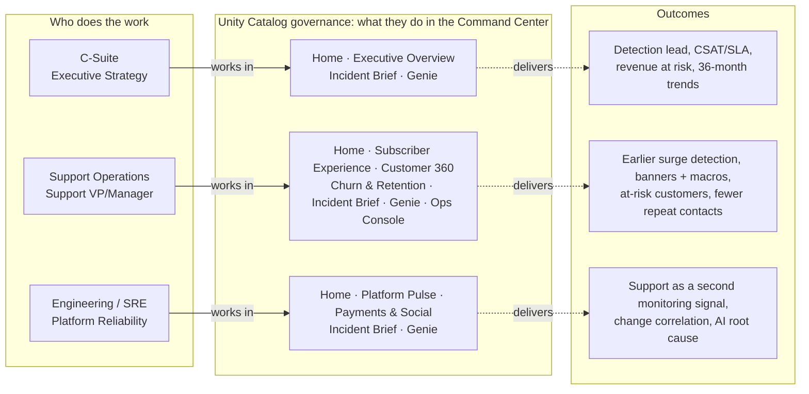
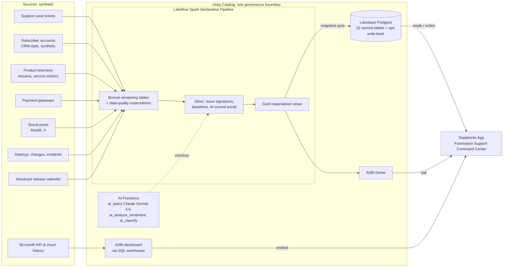
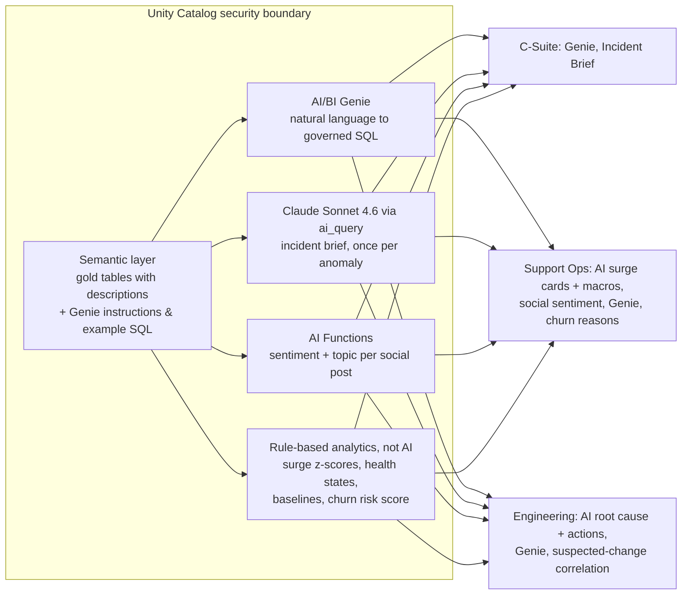

# Fanimation Support Command Center

> **Customers are the fastest monitoring system you have.**
> A Databricks App that treats support tickets, social posts and subscriber accounts as a real-time signal of platform health, side by side with engineering telemetry, so a streaming business can see breakage from the fan's point of view, act on it, and see which customers are at risk because of it.

Fanimation is a fictional anime streaming (OTT) service. **All data in this demo is synthetic.**

---

## 1. About the Support Command Center

> When a server quietly drops sessions or a subtitle pack fails to publish, subscribers notice before internal alerts fire. The Command Center combines support tickets, subscriber accounts, product telemetry, payments and social posts in one governed place, so Fanimation can see breakage from the fan's point of view, act on it, and see which customers are at risk because of it.
>
> *(Same text as the app's About page.)*

### The customer-support challenge in streaming / OTT

Streaming support teams face problems that classic monitoring does not catch well:

* **Silent failures.** A player SDK quietly drops sessions on one device in one country, or a subtitle pack fails validation during publish. Server dashboards stay green while fans can't watch.
* **Customers notice first.** Viewers report the problem through tickets, chat and social media minutes (sometimes hours) before an internal alert fires or an incident is declared.
* **Spikes are not always bad.** A simulcast finale drives a legitimate traffic and contact spike. Teams need to tell a benign release spike from real breakage.
* **Global, multilingual, multi-device.** Tickets arrive in English, Spanish, Portuguese, German and French, across TVs, consoles, mobile and web, in 20 countries and 4 regions.
* **Fragmented data.** Tickets live in the ticketing tool, accounts in the CRM, telemetry in observability tools, payments with the gateways and social chatter elsewhere. Nobody sees the whole picture.
* **Payments and churn.** Gateway failures silently cost revenue, and fans who hit repeated problems contact support again and again and eventually cancel.

### What the Command Center does

* Global heatmap and a **service health matrix** (engineering domain x region) that separates *Known incidents* from **Customer-Detected** issues (tickets spiking with no internal alert).
* Concurrent streams vs a **release-aware baseline**, with support contact-rate divergence as a leading indicator.
* **Ticket-surge detection** with AI-written incident briefs: headline, summary, likely root cause, recommended actions and a customer macro.
* **Declare incidents and publish known-issue banners** to agents; actions are written back to Lakebase.
* **Customer 360** and **churn-risk cohorts** grouped by what went wrong.
* Payment-gateway health and **social listening** with AI sentiment and topic.
* **Genie** natural-language Q&A and an executive **AI/BI dashboard** with 36-month trends.

### Personas and business outcomes

| Persona | What they do in the app | Business value |
| --- | --- | --- |
| **C-Suite** (Executive Strategy) | Home (right now) · Executive Overview (Incident Performance, Customer Experience, Revenue Impact, Long-term Trends) · Incident Brief · Genie | One view of subscriber impact: detection lead vs monitoring, CSAT / SLA, revenue at risk from payment failures, 36-month trends |
| **Support Operations** (Support VP/Manager) | Home (known and AI-detected issues) · Subscriber Experience (Incidents, Payments, Social) · Customer 360 · Churn & Retention · Incident Brief · Genie · Ops Console | Catch surges early, publish banners and AI macros, see which customers are at risk and why, track repeat contacts |
| **Engineering / SRE** (Platform Reliability) | Home · Platform Pulse · Payments & Social · Incident Brief · Genie | Support as a second monitoring signal: customer-detected cells, telemetry vs contact-rate divergence, deploy / config-change correlation, AI root-cause summary |

All three personas share the **Alerts** page.

### Value for the domain owner

* **Head of Support:** a known issue is confirmed and messaged to agents (banner + AI customer macro) while the surge is still building, instead of after hundreds of duplicate tickets; at-risk customers are visible with the reason and a recommended action.
* **Head of Engineering / SRE:** customer contact rate becomes a second monitoring signal per domain and region, already correlated with the deploys and config changes that preceded it.
* **Executives:** one trusted, governed view of subscriber impact (detection lead time, CSAT / SLA, revenue at risk, lost viewing hours) with 36 months of history, from the same data the operators use.

### Outcomes the demo measures

* **Detection lead time**: minutes customers reported an issue before monitoring alerted.
* **Customer-Detected minutes** by region and domain.
* **SLA met rate and CSAT**, including during incidents.
* **Revenue at risk** from payment-gateway failures.
* **Estimated lost viewing hours** per incident.
* **Repeat contact rate** (same subscriber within 7 days).
* **At-risk subscribers and MRR at risk** (rule-based churn risk score; not an ML model).

### Demo storyline (base data, 13-27 Oct 2026, UTC)

| Time (27 Oct) | Event | What it shows |
| --- | --- | --- |
| 09:00 | APAC login failures (AUTH-503) after an auth token-cache change | Monitoring catches it in 4 minutes |
| 14:00 | *Blade of the Crimson Moon* finale simulcast | Benign, release-driven spike |
| 15:36 | Android TV **Error 1002** in Brazil / Mexico / Argentina after a player SDK deploy | Customer-Detected about 45 minutes before declaration |
| 18:00 | *Spirit Ronin* E3 ships without Spanish subtitles | Only support sees it |
| 20:00 | Adyen EU endpoint migration: German and Austrian payments fail | Revenue at risk climbs |

Earlier incidents (16, 20, 23 and 25 Oct) give the scorecard history. Live incidents are added during the demo with notebook 04.

---

## 2. Why Databricks: one platform, end to end

The whole solution (ingestion, transformation, AI, governance, low-latency serving, BI, natural-language Q&A and the application itself) runs on the Databricks Data Intelligence Platform. There is no separate operational database, BI server, vector store or app host to wire together.

| Capability | Databricks feature | How it is used here |
| --- | --- | --- |
| **Governance** | **Unity Catalog** | Every raw, silver, gold and history table lives in one Unity Catalog catalog, with table descriptions that also ground Genie. One permission model covers the pipeline, the AI/BI dashboard, Genie, Lakebase synced tables and the app's service principal. |
| **Streaming data engineering** | **Lakeflow Spark Declarative Pipelines** | `support_command_center_streaming`: serverless pipeline. Streaming bronze tables with data-quality expectations, then silver (multilingual ticket issue signatures, release-aware stream baselines, AI-enriched social posts), then gold materialized views (service health, heatmap, frustration index, ticket anomalies, payment health, incident scorecard, Subscriber 360 & churn risk, customer outcomes). Only new rows are processed on each update. |
| **GenAI in the pipeline** | **AI Functions** + **Foundation Model API** | `ai_query` with Claude Sonnet 4.6 writes the incident headline, summary, root cause, actions and customer macro, **once per new anomaly**. `ai_analyze_sentiment` and `ai_classify` score each new social post. |
| **Low-latency serving + write-back** | **Lakebase (serverless Postgres)** | 15 snapshot-synced tables (`lb_*`) serve every app page with millisecond lookups, e.g. Customer 360 over about 1M subscribers. The app writes incident declarations, known-issue banners and alert acknowledgements back to Lakebase (`command_center_ops`). |
| **Natural-language Q&A** | **AI/BI Genie** | A Genie space over the gold tables, with business definitions (Customer-Detected, detection lead, at-risk) and example SQL. Each persona gets suggested questions. |
| **BI / long-term trends** | **AI/BI dashboard** + **SQL warehouse** | 36-month trends, year-over-year and churn history from standalone synthetic history tables, embedded in Executive Overview. |
| **Application** | **Databricks Apps** | A Streamlit app with SSO and its own service principal. Persona-specific navigation; reads Lakebase, writes back to Lakebase, calls Genie, embeds the dashboard. |

**What is deliberately *not* AI:** ticket-surge detection (z-score vs an hour-of-day baseline), health states, release-aware baselines and the churn risk score are statistical or rule-based SQL. The demo uses no agents, no trained ML models and no LLM other than Claude Sonnet 4.6.

### Architecture: business view



### Architecture: platform and data flow



### Architecture: AI and serving



The app's **Architecture** page shows the same three diagrams interactively.

---

## 3. How to deploy and run the demo

### Assets in this workspace

Replace `<catalog>` with the Unity Catalog catalog you deploy to.

| Asset | Name / location |
| --- | --- |
| Catalog / schemas | `<catalog>.support_command_center` (raw + history), `<catalog>.support_command_center_sdp` (pipeline outputs) |
| Notebooks | `support_command_center/01_generate_synthetic_data`, `05_generate_subscribers`, `06_generate_history`, `04_live_event_generator` |
| Pipeline | `support_command_center_streaming`, source under `support_command_center/pipeline/transformations/` (bronze, silver, gold) |
| Lakebase | Project `support-command-center`, branch `production`, database `databricks_postgres`; serving schema `support_command_center_sdp`, ops schema `command_center_ops` |
| Genie space | Fanimation Support Command Center |
| AI/BI dashboard | Fanimation Support Command Center - Long-term Trends |
| SQL warehouse | Any serverless SQL warehouse |
| App | `support-command-center`, source `support_command_center/app/` (entry `command_center.py`) |
| Dashboard file | `support_command_center/Fanimation Support Command Center - Long-term Trends.lvdash.json` |
| Specs | `support_command_center/APP_SPEC_V2.md` (design spec; the README and code reflect the current state) |

Project layout (everything lives in one folder):

```
support_command_center/
├── README.md
├── APP_SPEC_V2.md
├── 01_generate_synthetic_data · 04_live_event_generator
├── 05_generate_subscribers · 06_generate_history
├── Fanimation Support Command Center - Long-term Trends.lvdash.json
├── app/            (command_center.py, app.yaml, requirements.txt)
└── pipeline/
    └── transformations/  (bronze/, silver/, gold/)
```

The earlier notebook-based build (notebooks `02_gold_layer_and_ai` / `03_lakebase_and_genie_setup`, app files `main.py` / `app.py` and their tables) has been removed; the pipeline and `command_center.py` are the only implementation, and schema `support_command_center` holds only the raw tables and the `gold_hist_*` history tables.

### Prerequisites

* A Unity Catalog-enabled workspace with serverless compute, a SQL warehouse, Databricks Apps and Lakebase.
* Access to the Foundation Model API endpoint `databricks-claude-sonnet-4-6` (used by `ai_query`), and to AI Functions.
* Permission to create schemas in the target catalog.

### Deploy from scratch (one time)

1. **Generate base data.** Run `01_generate_synthetic_data`: 15 days at 5-minute grain into the raw schema.
2. **Generate subscribers.** Run `05_generate_subscribers`: about 1M subscriber accounts plus ticket-to-subscriber links.
3. **Generate history.** Run `06_generate_history`: 36-month `gold_hist_kpi_monthly` and `gold_hist_churn_monthly` for the dashboard.
4. **Run the pipeline.** Start `support_command_center_streaming` (first run processes everything and calls the AI once per post and per anomaly).
5. **Create the Lakebase serving tables.** Create snapshot synced tables `support_command_center_sdp.lb_<name>` from these pipeline tables, then grant the app's service principal `USAGE` + `SELECT` on Postgres schema `support_command_center_sdp`:

   | Synced table | Source | Primary key |
   | --- | --- | --- |
   | lb_region_heatmap_5m | gold_region_heatmap_5m | ts, country_code |
   | lb_service_health_region_5m | gold_service_health_region_5m | ts, region_group, domain |
   | lb_frustration_index_5m | gold_frustration_index_5m | scope_type, scope, ts |
   | lb_ticket_anomalies | gold_ticket_anomalies | anomaly_id |
   | lb_incident_scorecard | gold_incident_scorecard | incident_id |
   | lb_signature_trends_15m | gold_signature_trends_15m | ts_15m, issue_signature |
   | lb_payment_health_5m | gold_payment_health_5m | ts, country_code, gateway |
   | lb_social_posts | gold_social_posts | post_id |
   | lb_exec_daily_kpis | gold_exec_daily_kpis | kpi_date, region_group |
   | lb_change_events | bronze_change_events | change_id |
   | lb_incidents | bronze_incidents | incident_id |
   | lb_subscriber_360 | gold_subscriber_360 | subscriber_id |
   | lb_subscriber_ticket_history | gold_subscriber_ticket_history | ticket_id |
   | lb_churn_risk_by_issue | gold_churn_risk_by_issue | churn_driver, primary_issue_domain, region_group |
   | lb_customer_outcomes_daily | gold_customer_outcomes_daily | kpi_date, region_group |

   Lookup indexes (also re-applied by notebook 04 after each sync):
   ```sql
   CREATE INDEX IF NOT EXISTS ix_sth_sub ON support_command_center_sdp.lb_subscriber_ticket_history (subscriber_id, created_at);
   CREATE INDEX IF NOT EXISTS ix_s360_risk ON support_command_center_sdp.lb_subscriber_360 (churn_risk_band, churn_risk_score DESC);
   CREATE INDEX IF NOT EXISTS ix_s360_email ON support_command_center_sdp.lb_subscriber_360 (email);
   ```
6. **Genie space.** Point it at the gold tables in `support_command_center_sdp` (including subscriber and churn tables) with the business definitions as instructions.
7. **Dashboard.** Publish the Long-term Trends dashboard with embedded credentials. To show it inside the app, a workspace admin must allow dashboard embedding for the app's domain (Settings → Security).
8. **Deploy the app.** Set `app.yaml` environment variables (`WAREHOUSE_ID`, `GENIE_SPACE_ID`, `DASHBOARD_ID`, `LAKEBASE_ENDPOINT_PATH`, `LAKEBASE_DATABASE`, `WORKSPACE_ID`), deploy from `support_command_center/app`, and grant the app's service principal:
   * `USE CATALOG`, `USE SCHEMA`, `SELECT` on both schemas
   * `CAN_USE` on the SQL warehouse
   * `CAN_RUN` on the Genie space, `CAN_READ` on the dashboard
   * `CAN_USE` on the Lakebase project, plus Postgres grants on `support_command_center_sdp` (read) and `command_center_ops` (the app creates and owns these tables)

### Run the demo

**Before you present**
* Start the app if it was stopped (it bills while running; stop it between demos).
* Do a dry run of notebook 04 once.
* Click **Reset demo actions** in the sidebar to clear previous declarations and banners.

**How time works.** The app runs on *data time*: "now" is the newest data point, not the wall clock, so the demo looks the same whenever you open it. It only moves forward when you run notebook 04.

**Create a live incident.** Run `04_live_event_generator` with widgets `scenario` and `minutes`. One run:
1. Appends new events (deploy or config change, incident, ticket surge, social posts, ticket-to-subscriber links).
2. Runs the streaming pipeline incrementally (new rows only; Claude writes one brief per new surge).
3. Re-syncs the 15 Lakebase tables and re-applies indexes.

The app detects the new data within about 60 seconds, or use **Refresh** in the top bar.

| Scenario | Incident declared after run start | To keep it under *AI-detected issues*, run `minutes` below |
| --- | --- | --- |
| `subtitles_missing` | 80 min | 80 (default 60 works) |
| `playback_error_1002` | 55 min | 55 (use 40) |
| `payment_gateway` | 55 min | 55 (use 40) |
| `login_outage` | 16 min | becomes known almost immediately (monitoring is fast) |
| `none` | - | normal traffic only |

**Suggested run of show**

| Step | Viewing as | Show |
| --- | --- | --- |
| 1 | Engineering / SRE | Health matrix and streams-vs-contacts chart: Customer-Detected cells and the divergence |
| 2 | Support Operations | Home (known vs AI-detected issues), then Subscriber Experience: declare the incident and publish a banner (written to Lakebase) |
| 3 | Support Operations | Churn & Retention: open a cohort and a customer, then Customer 360 and the link to the Incident Brief |
| 4 | Any | Incident Brief: AI headline, root cause, actions and customer macro |
| 5 | Any | Genie, e.g. "Why did Brazil turn red at 15:45 UTC on 2026-10-27?" |
| 6 | C-Suite | Home (right now), Executive Overview tabs, Long-term Trends dashboard |
| 7 | Any | Architecture page to close |

### Good to know

* **Reset demo actions** clears in-app declarations and banners for everyone (shared Lakebase tables). It does not clear alert acknowledgements, generator data or incidents that exist in the data.
* **A surge counts as active** for 30 minutes of data time after its last anomalous 15-minute window; after that it shows as *subsided* and can no longer be declared.
* **Declarations are app-side.** Declaring writes to `command_center_ops` and marks matching domain x region cells *Known*; it does not create an incident record in the pipeline.
* **Generator runs add up.** Each run moves "now" forward. After about a day's worth of runs the 27 Oct story falls out of last-24-hour views, and 15-day labels understate the range. To return to the baseline, restore the raw tables, run a full pipeline refresh and re-sync Lakebase.
* **Dates are fixed to October 2026** by design (synthetic, reproducible).
* **Synthetic data only.** Subscriber accounts are a CRM-style synthetic table; the churn score is rule-based, not a trained model.
